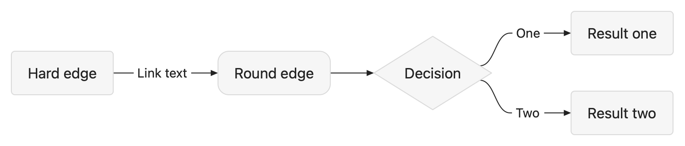
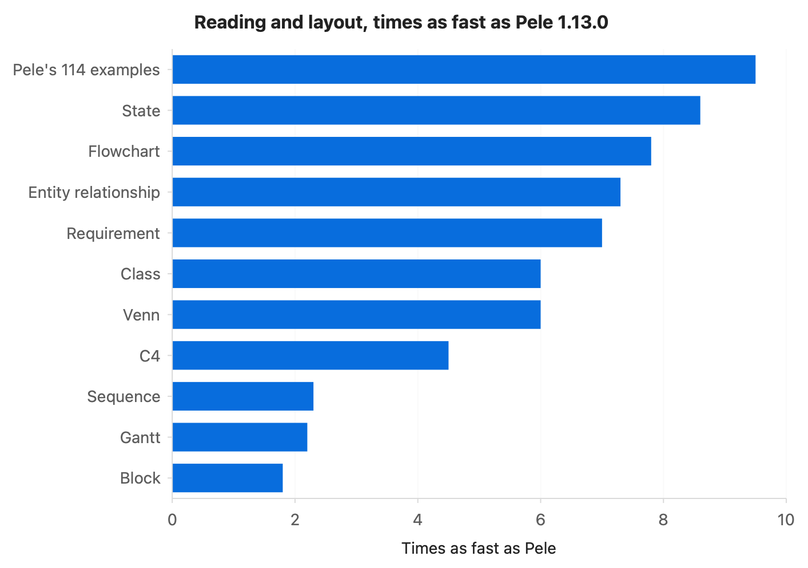

# MermaidDiagrams

Reads [Mermaid](https://mermaid.js.org) diagram text, lays the diagram out and draws it with Core Graphics and Core Text, in the visual style of [Pele](https://github.com/obsidianmd/pele), Obsidian's Mermaid renderer. It knows no app: fonts, colors and limits are parameters, and it reads and writes no file.

<picture>
  <source media="(prefers-color-scheme: dark)" srcset="docs/pictures/flowchart-dark.png">
  
</picture>

It was written for [Graphite](https://github.com/Graphite-Note/Graphite), whose plan for it, [Docs/Native-diagrams-todo.md](https://github.com/Graphite-Note/Graphite/blob/main/Docs/Native-diagrams-todo.md), records the decisions that shaped it. It needs iOS 26 or macOS 26 and depends on nothing but Foundation, CoreGraphics and CoreText.

## Using it

Add the package to your `Package.swift`:

```swift
.package(url: "https://github.com/Graphite-Note/MermaidDiagrams.git", exact: "0.8.1")
```

and the product `MermaidDiagrams` to your target's dependencies. Any diagram goes through one path:

```swift
import MermaidDiagrams

let typography = DiagramTypography(font: DiagramFont(postScriptName: nil, size: 16)) // Made once, kept for every diagram.
let prepared = try MermaidDiagramPreparation.prepare(source: text, typography: typography)
DiagramSceneRenderer.draw(prepared.scene, in: context, palette: palette)              // A CGContext whose y runs down.
let svg = prepared.svgDocument()                                                       // Or a standalone SVG.
```

A text that is not drawn throws a `MermaidDiagramPreparationFailure` saying why. [docs/API.md](docs/API.md) describes the rest.

## Diagram types

Every type Pele draws: flowcharts, sequence, class, state and entity relationship diagrams, user journeys, Gantt, pie, quadrant and XY charts, requirement diagrams, Git graphs, C4 diagrams, mindmaps, timelines, Sankey, block, packet, architecture and Venn diagrams, Kanban boards, radar charts, treemaps, Ishikawa diagrams, tree views, event models, railroad diagrams, Cynefin frameworks, Wardley maps, swimlanes, use case diagrams, agent flows and info diagrams.

[docs/Gallery.md](docs/Gallery.md) shows one example of each as the package draws it, and [docs/Diagram-types.md](docs/Diagram-types.md) says what is read and drawn of each.

## Speed

Measured on an Apple M5 Max against Pele 1.13.0's own benchmark on the same inputs, per diagram:

<picture>
  <source media="(prefers-color-scheme: dark)" srcset="docs/pictures/speed-dark.png">
  
</picture>

| Diagrams | Pele 1.13.0 | Read and laid out | Prepared with SVG |
|---|---:|---:|---:|
| Pele's 114 flowchart examples | 21.2 µs | 2.2 µs (9.5×) | 3.8 µs (5.6×) |
| State diagrams | 39.4 µs | 4.6 µs (8.6×) | 7.9 µs (5.0×) |
| Class diagrams | 22.6 µs | 3.8 µs (6.0×) | 6.6 µs (3.4×) |
| Sequence diagrams | 10.1 µs | 4.4 µs (2.3×) | 7.8 µs (1.3×) |
| Block diagrams | 5.8 µs | 3.1 µs (1.8×) | 4.9 µs (1.2×) |

Every type reads, lays out and writes its SVG faster than Pele's `render`, and 0.8.0 reads and lays out 1.1 to 5.4 times as fast as 0.7.0 with the same drawings. [docs/Benchmarks.md](docs/Benchmarks.md) has every type, the iOS simulators and how it is measured.

## Documentation

- [Gallery](docs/Gallery.md): one example of every type, light and dark.
- [Diagram types](docs/Diagram-types.md): what is read and drawn of each type, and the theme palettes.
- [Public API](docs/API.md): the types a host uses, narrow columns and limits.
- [Layout](docs/Layout.md): the layered and compound layouts, and where the scenes differ from Graphite's old views.
- [Tests](docs/Tests.md) and [benchmarks](docs/Benchmarks.md): how the package is checked against Pele and timed.

## License and credits

MIT (see `LICENSE`). The visual style, the spacing and the shapes' geometry follow [Pele](https://github.com/obsidianmd/pele), Copyright (c) 2026 kepano, MIT licensed (`PELE-LICENSE`). The code is written for this package. It imports Foundation, CoreGraphics and CoreText only, with no UIKit, AppKit or SwiftUI.
