# Gallery

One of Mermaid's documentation examples of every type, as the package draws it: prepared by `MermaidDiagramPreparation.prepare` at Pele's 16-point text in the system font and painted by `DiagramSceneRenderer` at two pixels per point, in the colors Obsidian's default theme gives Pele (`app.css` maps Pele's roles to the theme's background, text, border and accent colors, and the eight series to its blue, orange, green, red, cyan, yellow, purple and pink), light or dark as your page is. The pictures are cropped to the diagram and kept to 256 colors each. `swift run -c release MermaidDiagramsBenchmark --readme-pictures docs/pictures` paints them again and prints this section (`ReadmePictures`, which names the example of each type); with `--every-example` it paints every example of every type instead, to choose from.

## Flowchart

<picture>
  <source media="(prefers-color-scheme: dark)" srcset="pictures/flowchart-dark.png">
  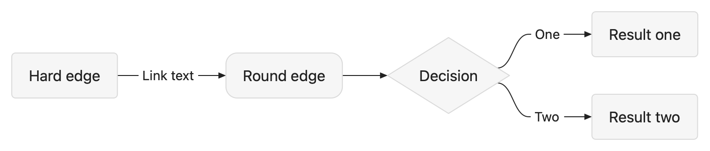
</picture>

<details><summary>Source</summary>

```text
flowchart LR
    A[Hard edge] -->|Link text| B(Round edge)
    B --> C{Decision}
    C -->|One| D[Result one]
    C -->|Two| E[Result two]
```

</details>

## Sequence diagram

<picture>
  <source media="(prefers-color-scheme: dark)" srcset="pictures/sequence-dark.png">
  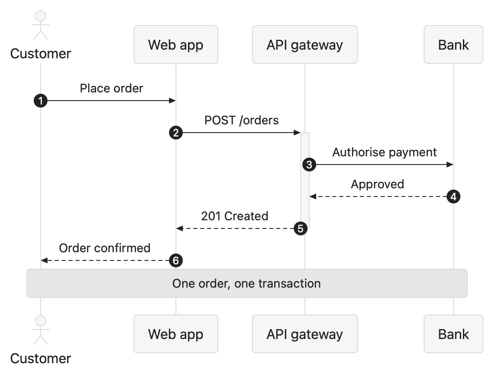
</picture>

<details><summary>Source</summary>

```text
sequenceDiagram
  autonumber
  actor Customer
  participant Web as Web app
  participant API as API gateway
  participant Bank
  Customer->>Web: Place order
  Web->>API: POST /orders
  activate API
  API->>Bank: Authorise payment
  Bank-->>API: Approved
  API-->>Web: 201 Created
  deactivate API
  Web-->>Customer: Order confirmed
  Note over Customer,Bank: One order, one transaction
```

</details>

## Class diagram

<picture>
  <source media="(prefers-color-scheme: dark)" srcset="pictures/class-dark.png">
  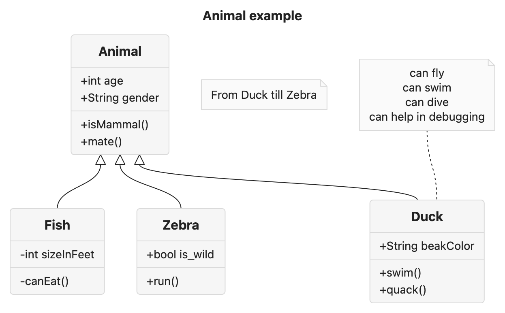
</picture>

<details><summary>Source</summary>

```text
---
title: Animal example
---
classDiagram
    note "From Duck till Zebra"
    Animal <|-- Duck
    note for Duck "can fly<br>can swim<br>can dive<br>can help in debugging"
    Animal <|-- Fish
    Animal <|-- Zebra
    Animal : +int age
    Animal : +String gender
    Animal: +isMammal()
    Animal: +mate()
    class Duck{
        +String beakColor
        +swim()
        +quack()
    }
    class Fish{
        -int sizeInFeet
        -canEat()
    }
    class Zebra{
        +bool is_wild
        +run()
    }
```

</details>

## State diagram

<picture>
  <source media="(prefers-color-scheme: dark)" srcset="pictures/state-dark.png">
  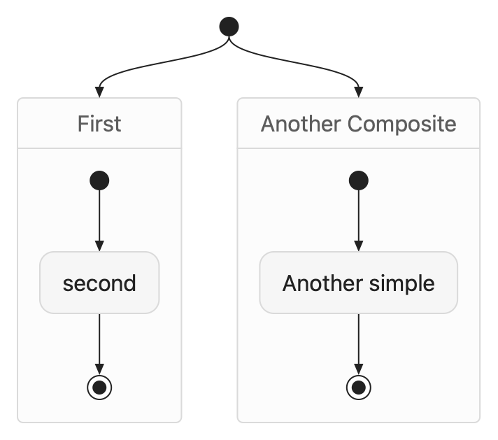
</picture>

<details><summary>Source</summary>

```text
stateDiagram-v2
    [*] --> First
    state First {
        [*] --> second
        second --> [*]
    }

    [*] --> NamedComposite
    NamedComposite: Another Composite
    state NamedComposite {
        [*] --> namedSimple
        namedSimple --> [*]
        namedSimple: Another simple
    }
```

</details>

## Entity relationship diagram

<picture>
  <source media="(prefers-color-scheme: dark)" srcset="pictures/er-dark.png">
  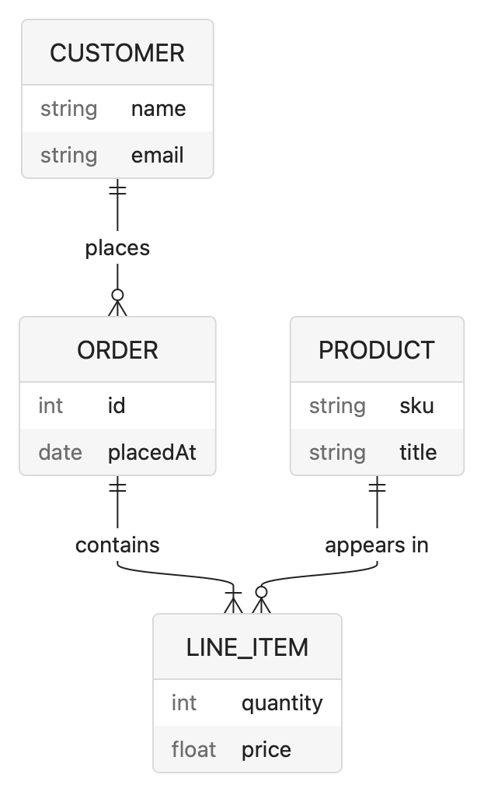
</picture>

<details><summary>Source</summary>

```text
erDiagram
  CUSTOMER ||--o{ ORDER : places
  ORDER ||--|{ LINE_ITEM : contains
  PRODUCT ||--o{ LINE_ITEM : "appears in"
  CUSTOMER {
    string name
    string email
  }
  ORDER {
    int id
    date placedAt
  }
  LINE_ITEM {
    int quantity
    float price
  }
  PRODUCT {
    string sku
    string title
  }
```

</details>

## User journey

<picture>
  <source media="(prefers-color-scheme: dark)" srcset="pictures/journey-dark.png">
  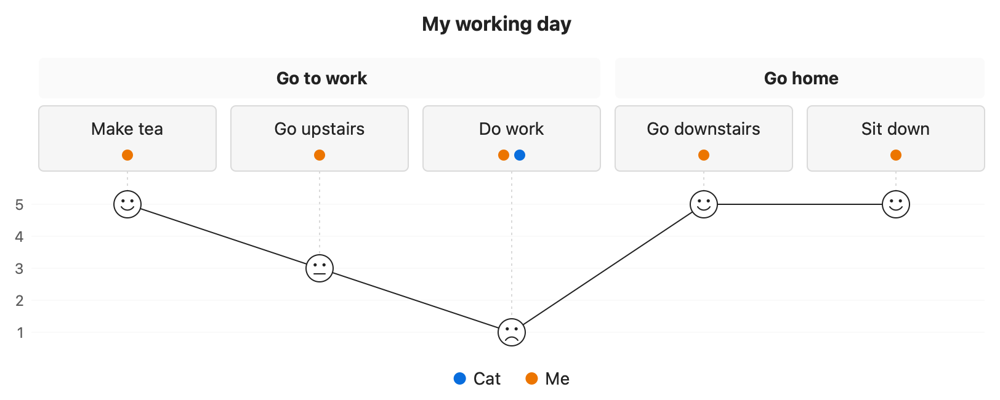
</picture>

<details><summary>Source</summary>

```text
journey
    title My working day
    section Go to work
      Make tea: 5: Me
      Go upstairs: 3: Me
      Do work: 1: Me, Cat
    section Go home
      Go downstairs: 5: Me
      Sit down: 5: Me
```

</details>

## Gantt chart

<picture>
  <source media="(prefers-color-scheme: dark)" srcset="pictures/gantt-dark.png">
  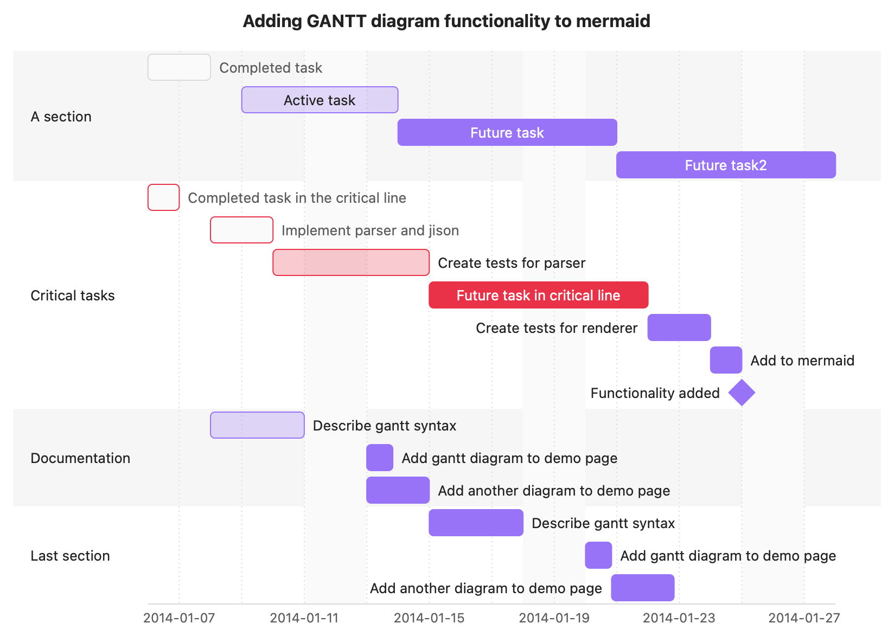
</picture>

<details><summary>Source</summary>

```text
gantt
    dateFormat  YYYY-MM-DD
    title       Adding GANTT diagram functionality to mermaid
    excludes    weekends
    %% (`excludes` accepts specific dates in YYYY-MM-DD format, days of the week ("sunday") or "weekends", but not the word "weekdays".)

    section A section
    Completed task            :done,    des1, 2014-01-06,2014-01-08
    Active task               :active,  des2, 2014-01-09, 3d
    Future task               :         des3, after des2, 5d
    Future task2              :         des4, after des3, 5d

    section Critical tasks
    Completed task in the critical line :crit, done, 2014-01-06,24h
    Implement parser and jison          :crit, done, after des1, 2d
    Create tests for parser             :crit, active, 3d
    Future task in critical line        :crit, 5d
    Create tests for renderer           :2d
    Add to mermaid                      :until isadded
    Functionality added                 :milestone, isadded, 2014-01-25, 0d

    section Documentation
    Describe gantt syntax               :active, a1, after des1, 3d
    Add gantt diagram to demo page      :after a1  , 20h
    Add another diagram to demo page    :doc1, after a1  , 48h

    section Last section
    Describe gantt syntax               :after doc1, 3d
    Add gantt diagram to demo page      :20h
    Add another diagram to demo page    :48h
```

</details>

## Pie chart

<picture>
  <source media="(prefers-color-scheme: dark)" srcset="pictures/pie-dark.png">
  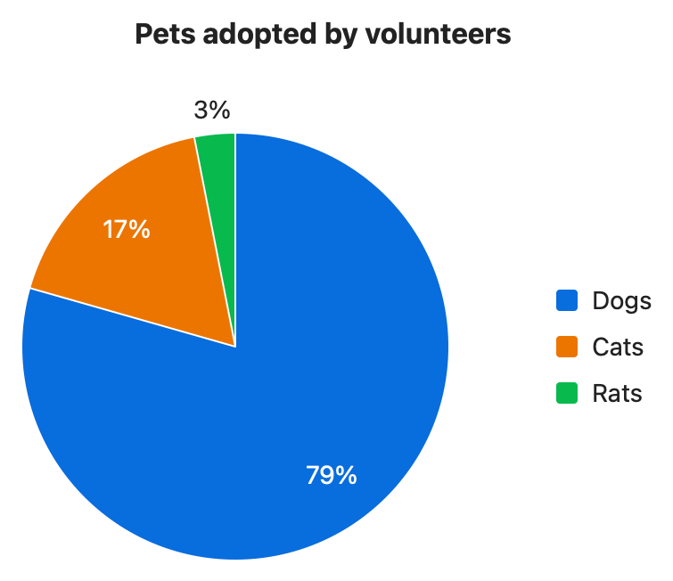
</picture>

<details><summary>Source</summary>

```text
pie title Pets adopted by volunteers
    "Dogs" : 386
    "Cats" : 85
    "Rats" : 15
```

</details>

## Quadrant chart

<picture>
  <source media="(prefers-color-scheme: dark)" srcset="pictures/quadrantChart-dark.png">
  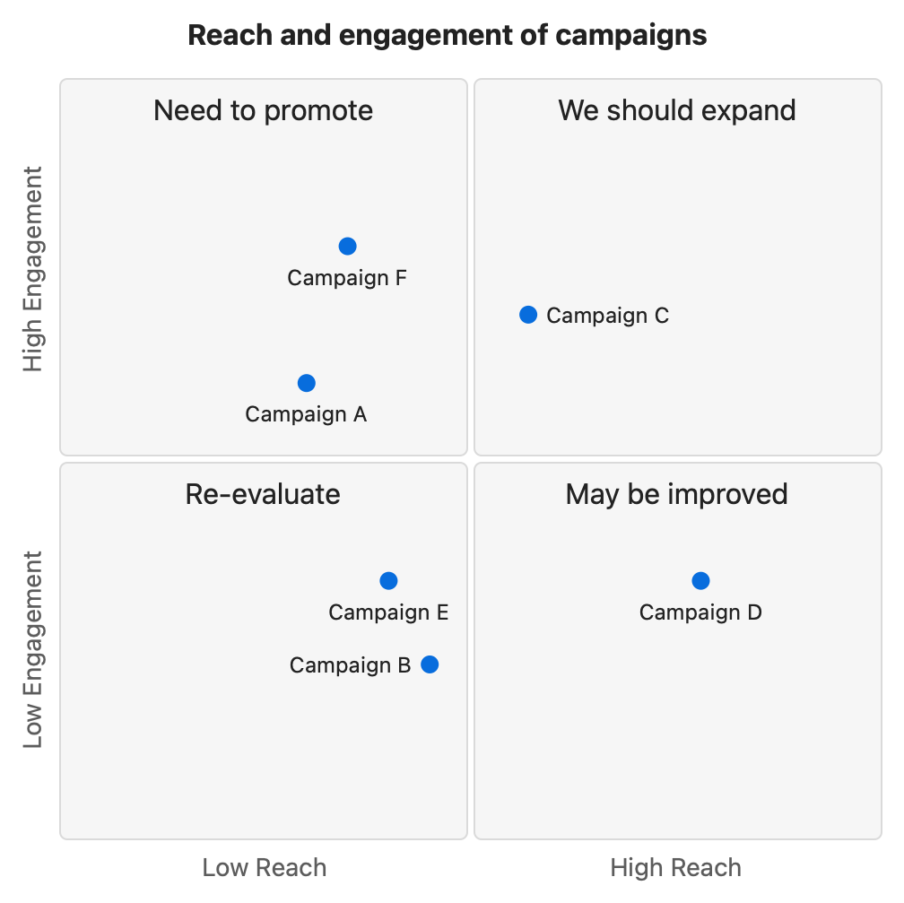
</picture>

<details><summary>Source</summary>

```text
quadrantChart
    title Reach and engagement of campaigns
    x-axis Low Reach --> High Reach
    y-axis Low Engagement --> High Engagement
    quadrant-1 We should expand
    quadrant-2 Need to promote
    quadrant-3 Re-evaluate
    quadrant-4 May be improved
    Campaign A: [0.3, 0.6]
    Campaign B: [0.45, 0.23]
    Campaign C: [0.57, 0.69]
    Campaign D: [0.78, 0.34]
    Campaign E: [0.40, 0.34]
    Campaign F: [0.35, 0.78]
```

</details>

## Requirement diagram

<picture>
  <source media="(prefers-color-scheme: dark)" srcset="pictures/requirement-dark.png">
  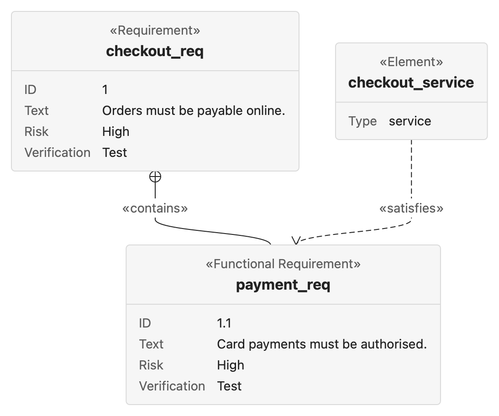
</picture>

<details><summary>Source</summary>

```text
requirementDiagram
  requirement checkout_req {
    id: 1
    text: Orders must be payable online.
    risk: high
    verifymethod: test
  }
  functionalRequirement payment_req {
    id: 1.1
    text: Card payments must be authorised.
    risk: high
    verifymethod: test
  }
  element checkout_service {
    type: service
  }
  checkout_req - contains -> payment_req
  checkout_service - satisfies -> payment_req
```

</details>

## Git graph

<picture>
  <source media="(prefers-color-scheme: dark)" srcset="pictures/gitGraph-dark.png">
  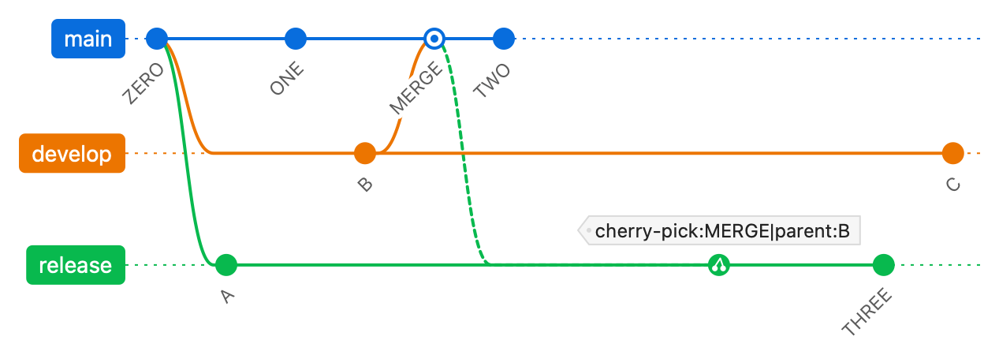
</picture>

<details><summary>Source</summary>

```text
    gitGraph
        commit id: "ZERO"
        branch develop
        branch release
        commit id:"A"
        checkout main
        commit id:"ONE"
        checkout develop
        commit id:"B"
        checkout main
        merge develop id:"MERGE"
        commit id:"TWO"
        checkout release
        cherry-pick id:"MERGE" parent:"B"
        commit id:"THREE"
        checkout develop
        commit id:"C"
```

</details>

## C4 diagram

<picture>
  <source media="(prefers-color-scheme: dark)" srcset="pictures/c4-dark.png">
  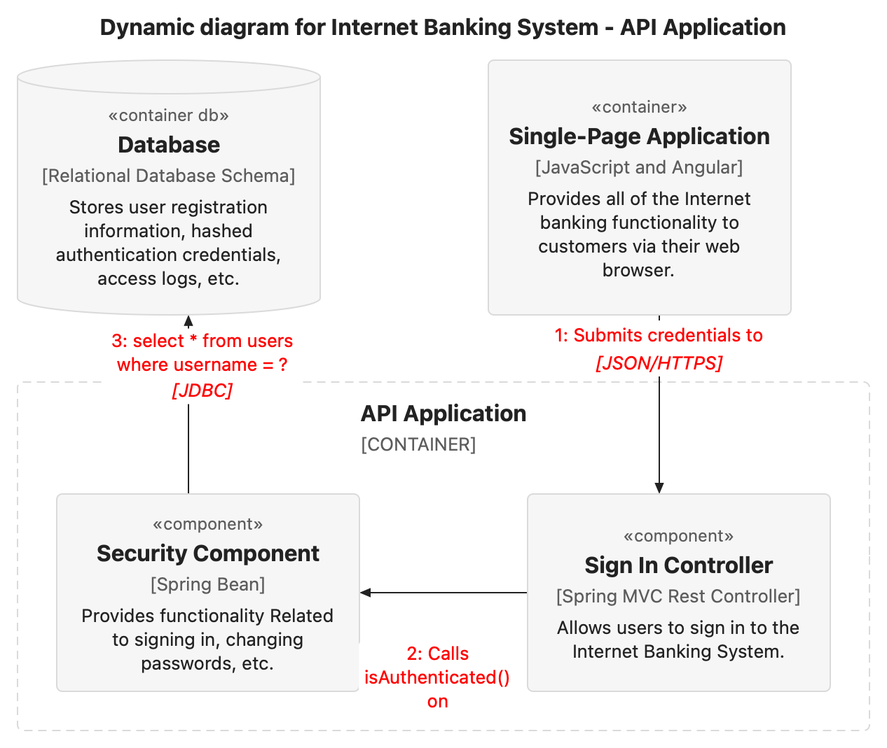
</picture>

<details><summary>Source</summary>

```text
    C4Dynamic
    title Dynamic diagram for Internet Banking System - API Application

    ContainerDb(c4, "Database", "Relational Database Schema", "Stores user registration information, hashed authentication credentials, access logs, etc.")
    Container(c1, "Single-Page Application", "JavaScript and Angular", "Provides all of the Internet banking functionality to customers via their web browser.")
    Container_Boundary(b, "API Application") {
      Component(c3, "Security Component", "Spring Bean", "Provides functionality Related to signing in, changing passwords, etc.")
      Component(c2, "Sign In Controller", "Spring MVC Rest Controller", "Allows users to sign in to the Internet Banking System.")
    }
    Rel(c1, c2, "Submits credentials to", "JSON/HTTPS")
    Rel(c2, c3, "Calls isAuthenticated() on")
    Rel(c3, c4, "select * from users where username = ?", "JDBC")

    UpdateRelStyle(c1, c2, $textColor="red", $offsetY="-40")
    UpdateRelStyle(c2, c3, $textColor="red", $offsetX="-40", $offsetY="60")
    UpdateRelStyle(c3, c4, $textColor="red", $offsetY="-40", $offsetX="10")
```

</details>

## Mindmap

<picture>
  <source media="(prefers-color-scheme: dark)" srcset="pictures/mindmap-dark.png">
  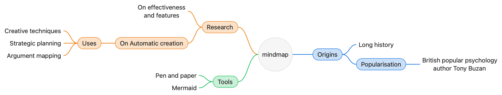
</picture>

<details><summary>Source</summary>

```text
mindmap
  root((mindmap))
    Origins
      Long history
      ::icon(fa fa-book)
      Popularisation
        British popular psychology author Tony Buzan
    Research
      On effectiveness<br/>and features
      On Automatic creation
        Uses
            Creative techniques
            Strategic planning
            Argument mapping
    Tools
      Pen and paper
      Mermaid
```

</details>

## Timeline

<picture>
  <source media="(prefers-color-scheme: dark)" srcset="pictures/timeline-dark.png">
  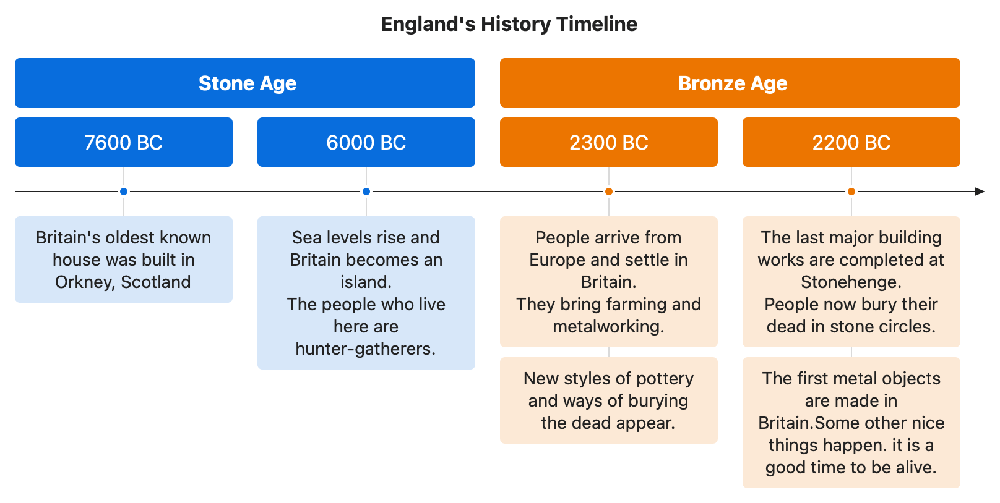
</picture>

<details><summary>Source</summary>

```text
timeline
        title England's History Timeline
        section Stone Age
          7600 BC : Britain's oldest known house was built in Orkney, Scotland
          6000 BC : Sea levels rise and Britain becomes an island.<br> The people who live here are hunter-gatherers.
        section Bronze Age
          2300 BC : People arrive from Europe and settle in Britain. <br>They bring farming and metalworking.
                  : New styles of pottery and ways of burying the dead appear.
          2200 BC : The last major building works are completed at Stonehenge.<br> People now bury their dead in stone circles.
                  : The first metal objects are made in Britain.Some other nice things happen. it is a good time to be alive.
```

</details>

## Sankey diagram

<picture>
  <source media="(prefers-color-scheme: dark)" srcset="pictures/sankey-dark.png">
  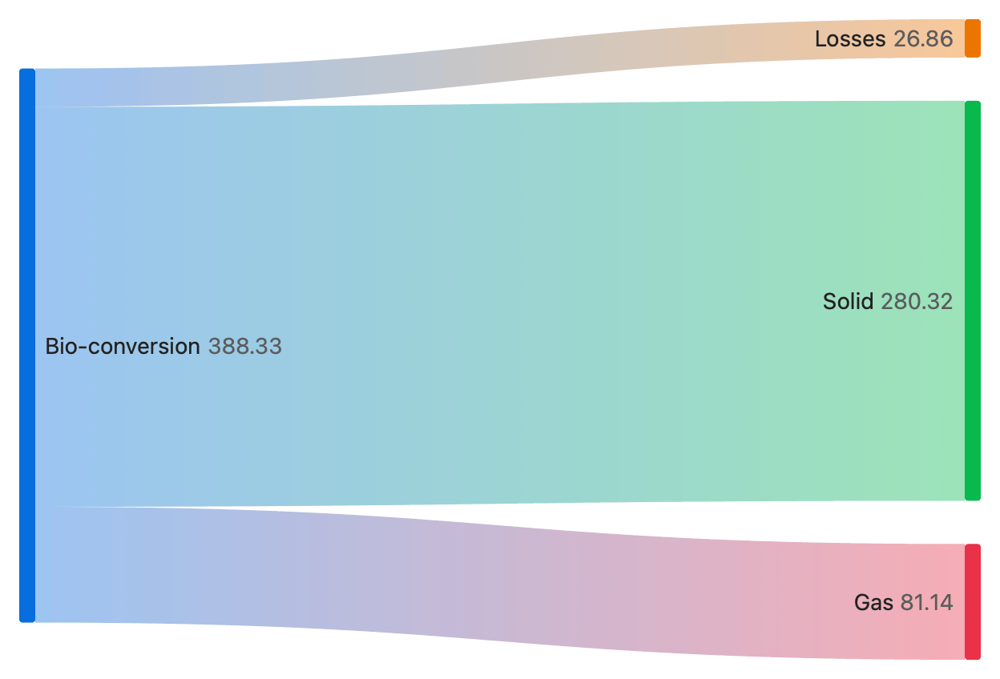
</picture>

<details><summary>Source</summary>

```text
sankey

Bio-conversion,Losses,26.862

Bio-conversion,Solid,280.322

Bio-conversion,Gas,81.144
```

</details>

## XY chart

<picture>
  <source media="(prefers-color-scheme: dark)" srcset="pictures/xychart-dark.png">
  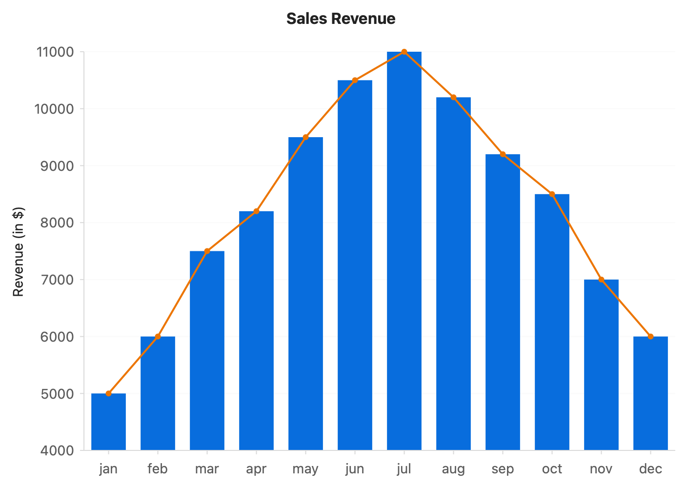
</picture>

<details><summary>Source</summary>

```text
xychart
    title "Sales Revenue"
    x-axis [jan, feb, mar, apr, may, jun, jul, aug, sep, oct, nov, dec]
    y-axis "Revenue (in $)" 4000 --> 11000
    bar [5000, 6000, 7500, 8200, 9500, 10500, 11000, 10200, 9200, 8500, 7000, 6000]
    line [5000, 6000, 7500, 8200, 9500, 10500, 11000, 10200, 9200, 8500, 7000, 6000]
```

</details>

## Block diagram

<picture>
  <source media="(prefers-color-scheme: dark)" srcset="pictures/block-dark.png">
  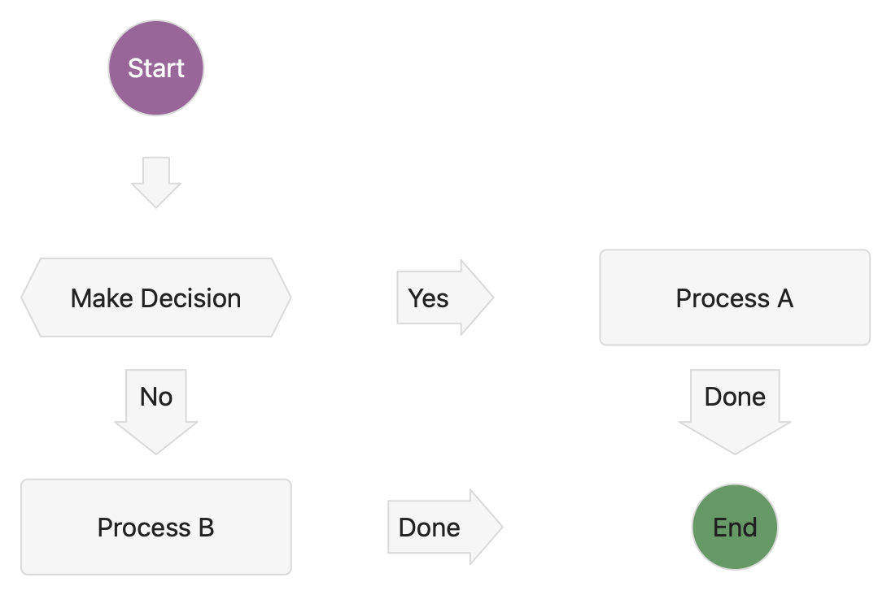
</picture>

<details><summary>Source</summary>

```text
block
  columns 3
  Start(("Start")) space:2
  down<[" "]>(down) space:2
  Decision{{"Make Decision"}} right<["Yes"]>(right) Process1["Process A"]
  downAgain<["No"]>(down) space r3<["Done"]>(down)
  Process2["Process B"] r2<["Done"]>(right) End(("End"))

  style Start fill:#969;
  style End fill:#696;
```

</details>

## Packet diagram

<picture>
  <source media="(prefers-color-scheme: dark)" srcset="pictures/packet-dark.png">
  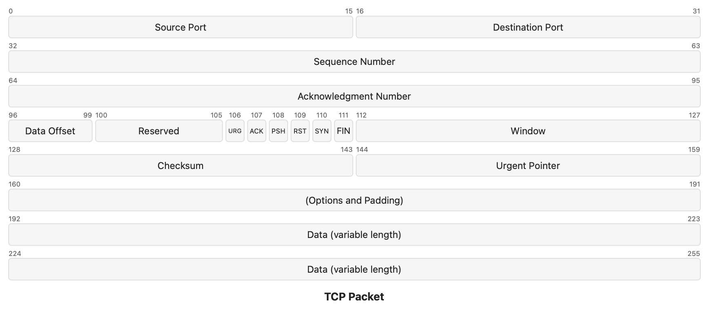
</picture>

<details><summary>Source</summary>

```text
---
title: "TCP Packet"
---
packet
0-15: "Source Port"
16-31: "Destination Port"
32-63: "Sequence Number"
64-95: "Acknowledgment Number"
96-99: "Data Offset"
100-105: "Reserved"
106: "URG"
107: "ACK"
108: "PSH"
109: "RST"
110: "SYN"
111: "FIN"
112-127: "Window"
128-143: "Checksum"
144-159: "Urgent Pointer"
160-191: "(Options and Padding)"
192-255: "Data (variable length)"
```

</details>

## Kanban board

<picture>
  <source media="(prefers-color-scheme: dark)" srcset="pictures/kanban-dark.png">
  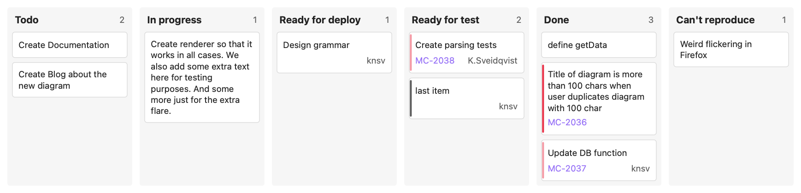
</picture>

<details><summary>Source</summary>

```text
---
config:
  kanban:
    ticketBaseUrl: 'https://mermaidchart.atlassian.net/browse/#TICKET#'
---
kanban
  Todo
    [Create Documentation]
    docs[Create Blog about the new diagram]
  [In progress]
    id6[Create renderer so that it works in all cases. We also add some extra text here for testing purposes. And some more just for the extra flare.]
  id9[Ready for deploy]
    id8[Design grammar]@{ assigned: 'knsv' }
  id10[Ready for test]
    id4[Create parsing tests]@{ ticket: MC-2038, assigned: 'K.Sveidqvist', priority: 'High' }
    id66[last item]@{ priority: 'Very Low', assigned: 'knsv' }
  id11[Done]
    id5[define getData]
    id2[Title of diagram is more than 100 chars when user duplicates diagram with 100 char]@{ ticket: MC-2036, priority: 'Very High'}
    id3[Update DB function]@{ ticket: MC-2037, assigned: knsv, priority: 'High' }

  id12[Can't reproduce]
    id3[Weird flickering in Firefox]
```

</details>

## Architecture diagram

<picture>
  <source media="(prefers-color-scheme: dark)" srcset="pictures/architecture-dark.png">
  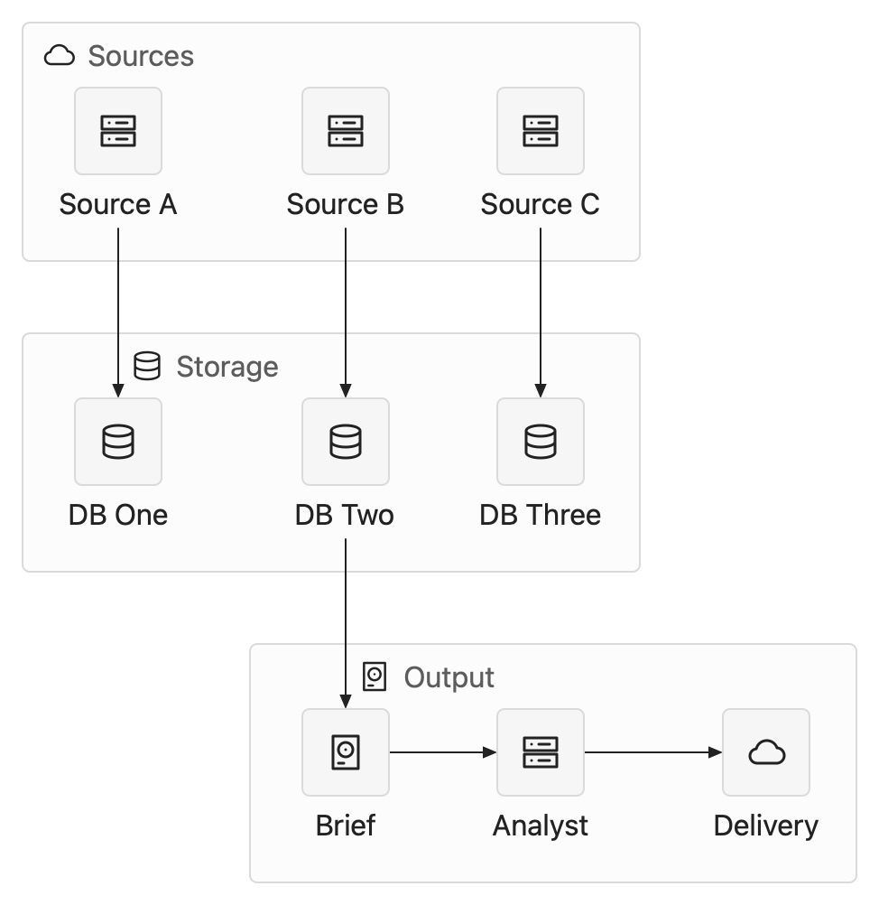
</picture>

<details><summary>Source</summary>

```text
architecture-beta
    group sources(cloud)[Sources]
        service src_a(server)[Source A] in sources
        service src_b(server)[Source B] in sources
        service src_c(server)[Source C] in sources

    group storage(database)[Storage]
        service db_one(database)[DB One] in storage
        service db_two(database)[DB Two] in storage
        service db_three(database)[DB Three] in storage

    group output(disk)[Output]
        service brief(disk)[Brief] in output
        service analyst(server)[Analyst] in output
        service delivery(cloud)[Delivery] in output

    src_a:B --> T:db_one
    src_b:B --> T:db_two
    src_c:B --> T:db_three
    db_two:B --> T:brief
    brief:R --> L:analyst
    analyst:R --> L:delivery

    align row src_a src_b src_c
    align row db_one db_two db_three
    align row brief analyst delivery

    align column src_a db_one
    align column src_b db_two brief
    align column src_c db_three
```

</details>

## Radar chart

<picture>
  <source media="(prefers-color-scheme: dark)" srcset="pictures/radar-dark.png">
  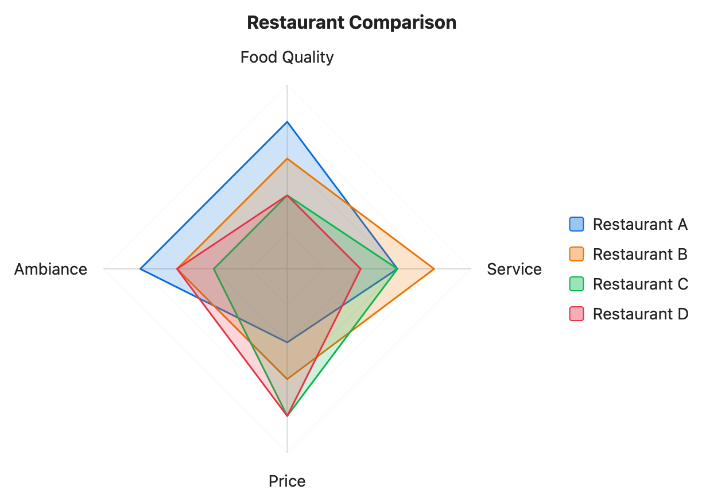
</picture>

<details><summary>Source</summary>

```text
radar-beta
  title Restaurant Comparison
  axis food["Food Quality"], service["Service"], price["Price"]
  axis ambiance["Ambiance"]

  curve a["Restaurant A"]{4, 3, 2, 4}
  curve b["Restaurant B"]{3, 4, 3, 3}
  curve c["Restaurant C"]{2, 3, 4, 2}
  curve d["Restaurant D"]{2, 2, 4, 3}

  graticule polygon
  max 5
```

</details>

## Treemap

<picture>
  <source media="(prefers-color-scheme: dark)" srcset="pictures/treemap-dark.png">
  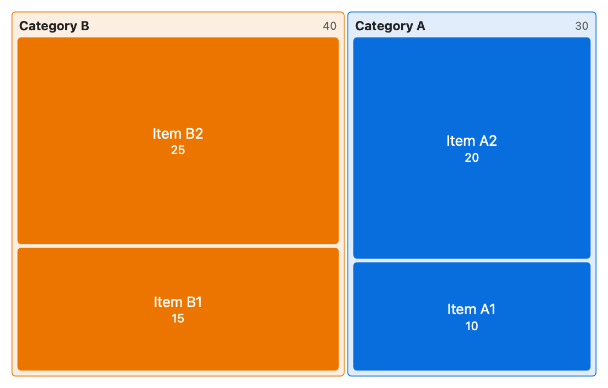
</picture>

<details><summary>Source</summary>

```text
---
config:
  treemap:
    diagramPadding: 200
---
treemap-beta
"Category A"
    "Item A1": 10
    "Item A2": 20
"Category B"
    "Item B1": 15
    "Item B2": 25
```

</details>

## Venn diagram

<picture>
  <source media="(prefers-color-scheme: dark)" srcset="pictures/venn-dark.png">
  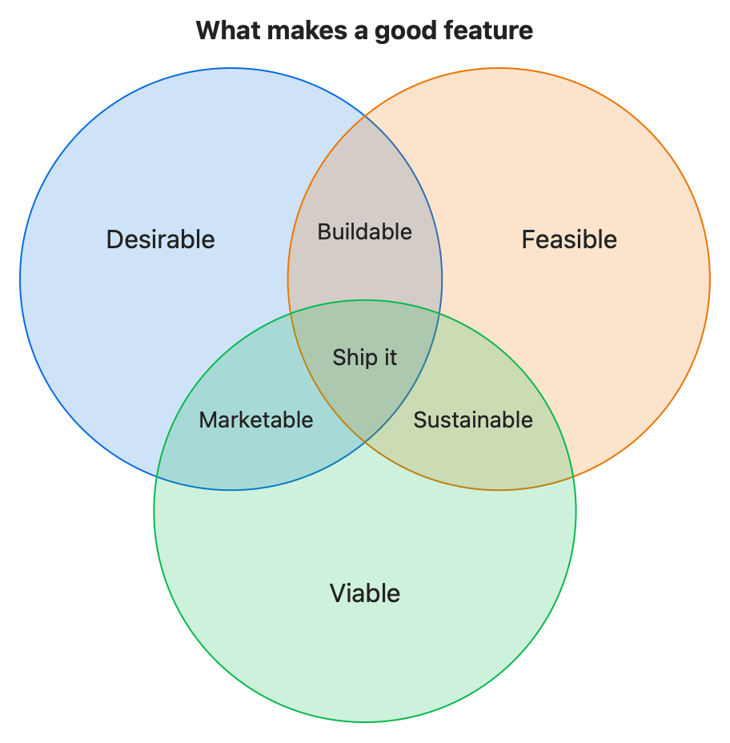
</picture>

<details><summary>Source</summary>

```text
venn-beta
  title What makes a good feature
  set Desirable
  set Feasible
  set Viable
  union Desirable,Feasible["Buildable"]
  union Feasible,Viable["Sustainable"]
  union Desirable,Viable["Marketable"]
  union Desirable,Feasible,Viable["Ship it"]
```

</details>

## Ishikawa diagram

<picture>
  <source media="(prefers-color-scheme: dark)" srcset="pictures/ishikawa-dark.png">
  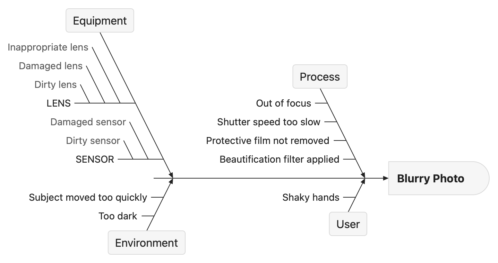
</picture>

<details><summary>Source</summary>

```text
ishikawa-beta
    Blurry Photo
    Process
        Out of focus
        Shutter speed too slow
        Protective film not removed
        Beautification filter applied
    User
        Shaky hands
    Equipment
        LENS
            Inappropriate lens
            Damaged lens
            Dirty lens
        SENSOR
            Damaged sensor
            Dirty sensor
    Environment
        Subject moved too quickly
        Too dark
```

</details>

## Tree view

<picture>
  <source media="(prefers-color-scheme: dark)" srcset="pictures/treeView-dark.png">
  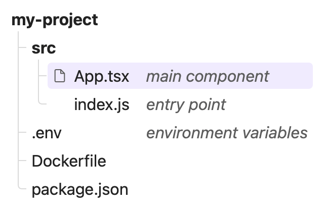
</picture>

<details><summary>Source</summary>

```text
treeView-beta
    my-project/
        src/
            App.tsx :::highlight icon(logos:react) ## main component
            index.js ## entry point
        .env ## environment variables
        Dockerfile
        package.json
```

</details>

## Event model

<picture>
  <source media="(prefers-color-scheme: dark)" srcset="pictures/eventmodeling-dark.png">
  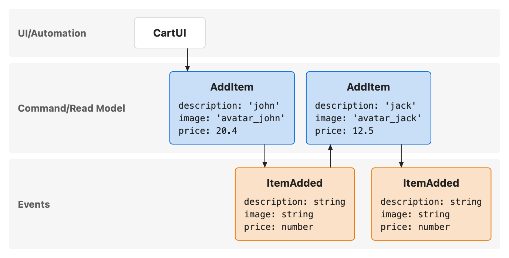
</picture>

<details><summary>Source</summary>

```text
eventmodeling

tf 01 ui CartUI
tf 02 cmd AddItem [[AddItem01]]
tf 03 evt ItemAdded [[ItemAdded]]
tf 04 cmd AddItem [[AddItem02]]
tf 05 evt ItemAdded [[ItemAdded]]

data AddItem01 {
  description: 'john'
  image: 'avatar_john'
  price: 20.4
}

data AddItem02 {
  description: 'jack'
  image: 'avatar_jack'
  price: 12.5
}

data ItemAdded {
  description: string
  image: string
  price: number
}
```

</details>

## Railroad diagram

<picture>
  <source media="(prefers-color-scheme: dark)" srcset="pictures/railroad-dark.png">
  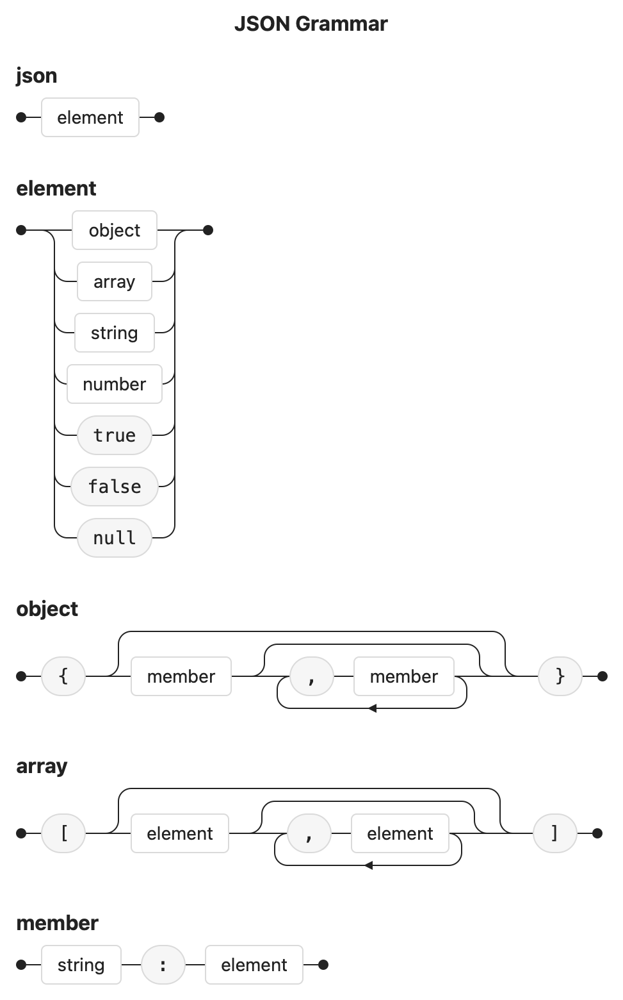
</picture>

<details><summary>Source</summary>

```text
railroad-ebnf-beta
title "JSON Grammar"

json = element ;
element = object | array | string | number | "true" | "false" | "null" ;
object = "{" [ member ( "," member )* ] "}" ;
array = "[" [ element ( "," element )* ] "]" ;
member = string ":" element ;
```

</details>

## Cynefin framework

<picture>
  <source media="(prefers-color-scheme: dark)" srcset="pictures/cynefin-dark.png">
  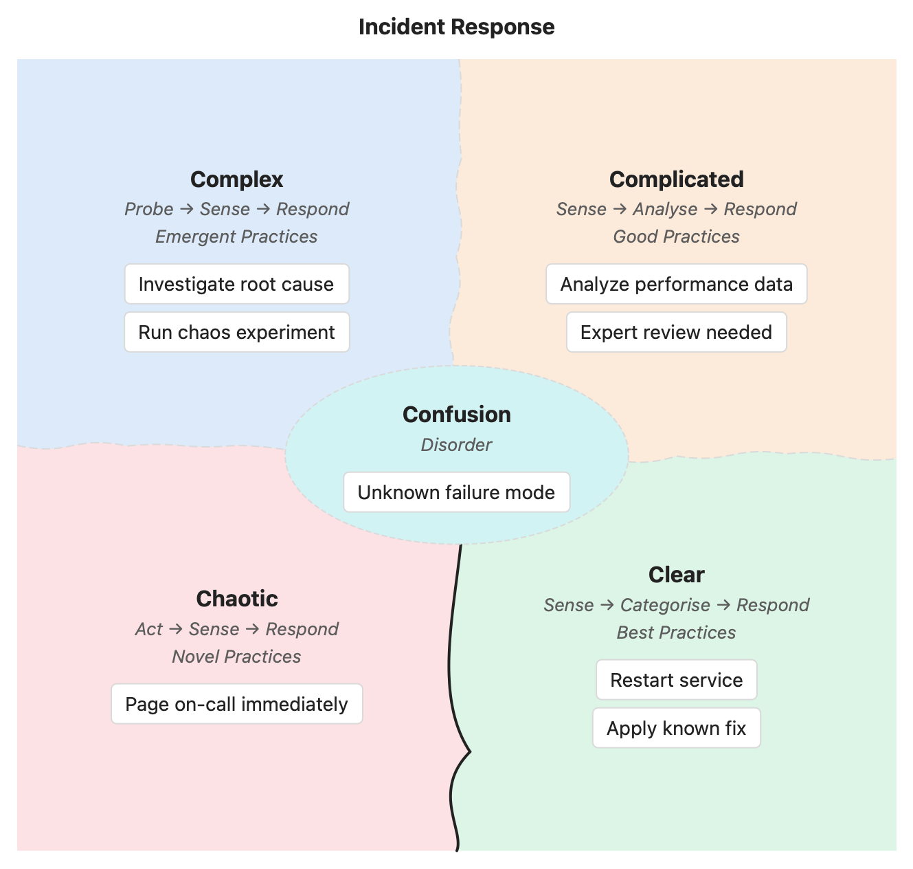
</picture>

<details><summary>Source</summary>

```text
cynefin-beta
  title Incident Response

  complex
    "Investigate root cause"
    "Run chaos experiment"

  complicated
    "Analyze performance data"
    "Expert review needed"

  clear
    "Restart service"
    "Apply known fix"

  chaotic
    "Page on-call immediately"

  confusion
    "Unknown failure mode"
```

</details>

## Wardley map

<picture>
  <source media="(prefers-color-scheme: dark)" srcset="pictures/wardley-dark.png">
  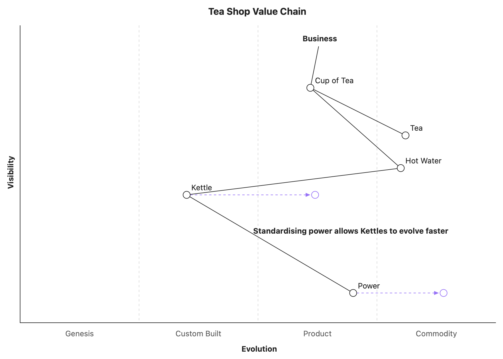
</picture>

<details><summary>Source</summary>

```text
wardley-beta
title Tea Shop Value Chain

anchor Business [0.95, 0.63]
component Cup of Tea [0.79, 0.61]
component Tea [0.63, 0.81]
component Hot Water [0.52, 0.80]
component Kettle [0.43, 0.35]
component Power [0.10, 0.70]

Business -> Cup of Tea
Cup of Tea -> Tea
Cup of Tea -> Hot Water
Hot Water -> Kettle
Kettle -> Power

evolve Kettle 0.62
evolve Power 0.89

note "Standardising power allows Kettles to evolve faster" [0.30, 0.49]
```

</details>

## Swimlane diagram

<picture>
  <source media="(prefers-color-scheme: dark)" srcset="pictures/swimlane-dark.png">
  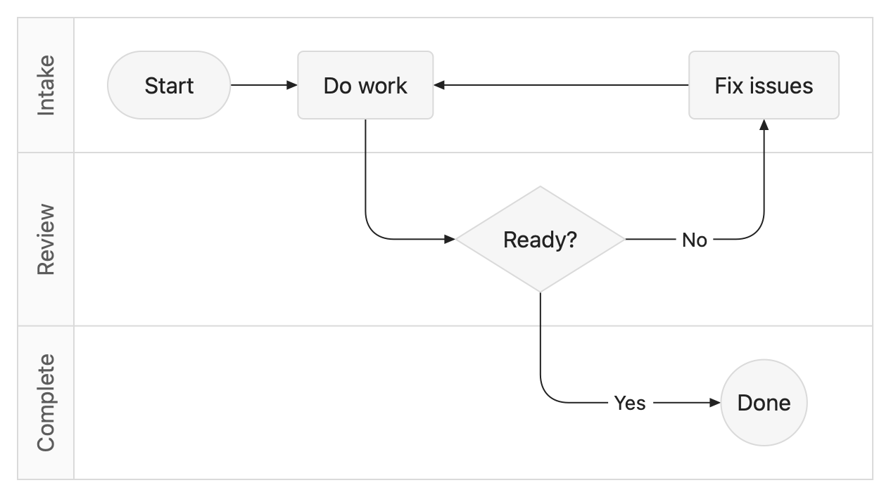
</picture>

<details><summary>Source</summary>

```text
swimlane-beta LR
  subgraph Intake
    start([Start])
    task[Do work]
    fix[Fix issues]
  end

  subgraph Review
    decision{Ready?}
  end

  subgraph Complete
    done((Done))
  end

  start --> task --> decision
  decision -->|Yes| done
  decision -->|No| fix
  fix --> task
```

</details>

## Use case diagram

<picture>
  <source media="(prefers-color-scheme: dark)" srcset="pictures/usecase-dark.png">
  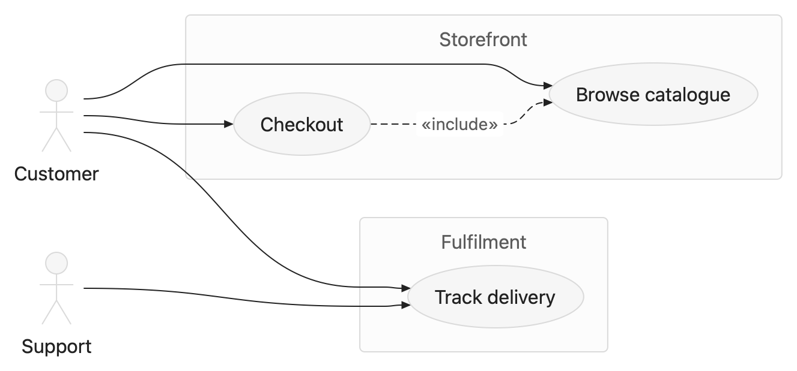
</picture>

<details><summary>Source</summary>

```text
usecase-beta
direction LR
actor Customer
actor Support
systemBoundary Storefront
  Browse("Browse catalogue")
  Checkout("Checkout")
end
systemBoundary Fulfilment
  Track("Track delivery")
end
Customer --> Browse
Customer --> Checkout
Customer --> Track
Support --> Track
Checkout ..> : include Browse
```

</details>

## Agent flow

<picture>
  <source media="(prefers-color-scheme: dark)" srcset="pictures/agentflow-dark.png">
  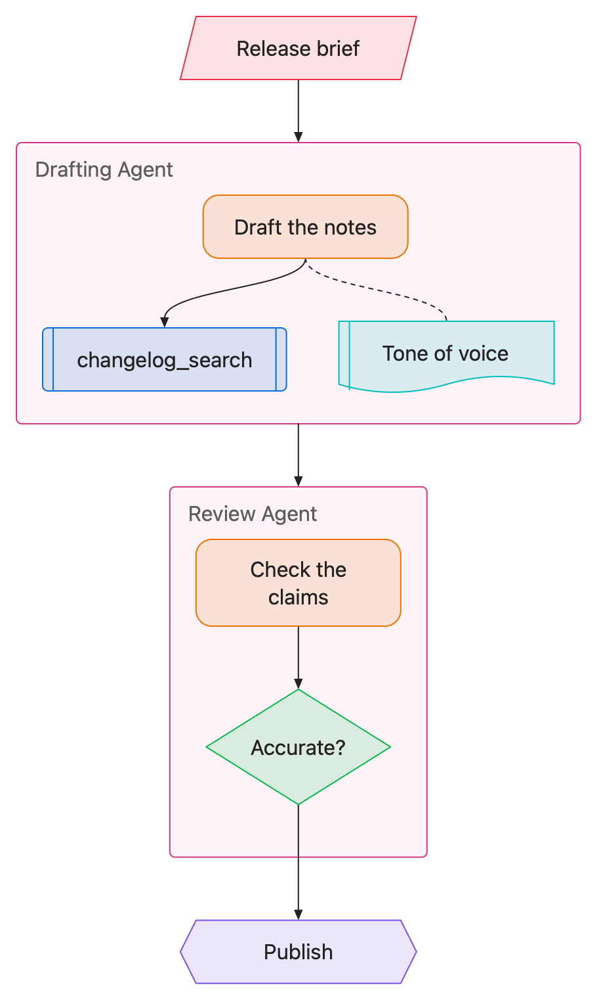
</picture>

<details><summary>Source</summary>

```text
agentflow-beta TB
  brief["Release brief"]@{ shape: input }
  flow writer["Drafting Agent"]
    draft["Draft the notes"]@{ shape: task }
    lookup["changelog_search"]@{ shape: tool }
    guide["Tone of voice"]@{ shape: refdoc }
    draft --> lookup
    draft -.- guide
  end
  flow reviewer["Review Agent"]
    check["Check the claims"]@{ shape: task }
    ok["Accurate?"]@{ shape: decision }
    check --> ok
  end
  publish["Publish"]@{ shape: action }
  brief --> writer
  writer --> reviewer
  ok --> publish
```

</details>

## Info diagram

<picture>
  <source media="(prefers-color-scheme: dark)" srcset="pictures/info-dark.png">
  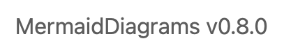
</picture>

<details><summary>Source</summary>

```text
info
```

</details>
